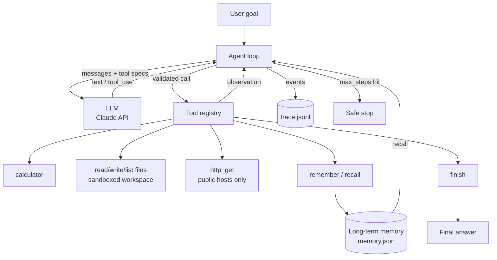

# Architecture

## Guardrails
| Risk | Control |
|---|---|
| Runaway loops | `max_steps` hard cap |
| File escape | `realpath` check confined to `workspace/` |
| SSRF | `http_get` blocks private/loopback/link-local IPs |
| Code injection | calculator uses AST whitelist, no `eval` |
| Tool misuse | `allowed_tools` allow-list |
| Tool crashes | errors returned as observations so the model can recover |
